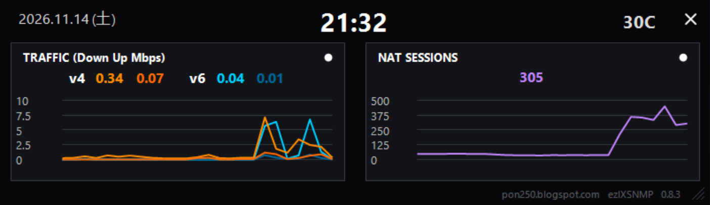
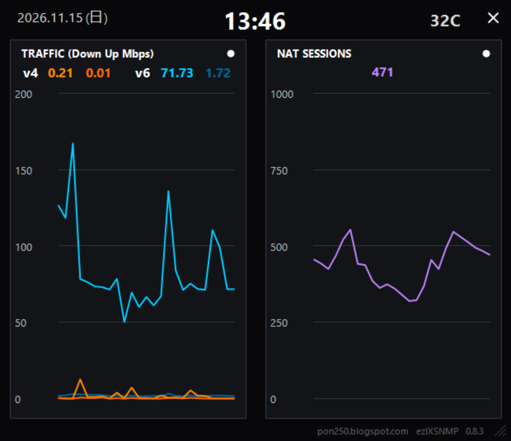

# ezIXSNMP

**IPv4・IPv6のトラフィックと、NATセッション数を並べて眺める。**

ezIXSNMPは、NEC UNIVERGE IXシリーズのTrafficとNAT Sessionsを、同じ画面で見比べるための小さなPowerShellスクリプトです。

この比較に特化し、軽量で、簡単に使えることを目指しています。

SNMP情報は5秒間隔で取得し、グラフには直近25ポイントを表示します。

ログの保存や長期的な監視、警告・通知などの機能はありません。そうした機能が必要な場合は、本格的なSNMP監視ソフトの利用をお勧めします。

Speedtestでは良い数字が出ているのに、通信が引っかかる。そんなとき、通信量だけでなく、ルーターのNATセッション数にも目を向けてみませんか。見えていなかったネットワークの様子が、問題を考える手掛かりになるかもしれません。

詳しい開発の経緯は「[開発ストーリー](開発ストーリー.md)」をご覧ください。

## 表示する情報

- **IPv4 Traffic**：ダウンロード / アップロードの通信量
- **IPv6 Traffic**：ダウンロード / アップロードの通信量
- **NAT Sessions**：ルーターのNATセッション数
- **Router Temp**：ルーター内部温度

ウィンドウは移動・サイズ変更ができ、デスクトップの片隅に置いて使えます。

## スクリーンショット

## 動作環境

動作確認済みの環境は次のとおりです。

| 項目 | 環境 |
|---|---|
| OS | Windows 11 |
| ルーター | NEC UNIVERGE IX2106 |
| ファームウェア | Ver.10.9.35 |
| 接続方式 | PPPoE |

上記以外の機種・環境は未検証です。IXシリーズであっても、機種・ファームウェア・ネットワーク構成によって取得できる情報は異なる場合があります。

## 必要なもの

- Windows 11
- Windows PowerShell 5.1以上
- SNMPに対応したNEC IXシリーズルーター
- ルーターのIPアドレス
- SNMPコミュニティ名

本スクリプトはPowerShellスクリプト1本で動作します。ブラウザー、WebView2、外部ライブラリは使用していません。

## 使い方

1. `ezIXSNMP.ps1` をダウンロードします。
2. テキストエディターで開き、冒頭の `User settings` を自分の環境に合わせて変更します。
3. ルーター側でSNMP v2cを有効にし、実行するPCからのSNMPアクセスを許可します。
4. `ezIXSNMP.ps1` をPowerShellから実行します。

主に変更する設定値は次の3つです。

| 設定 | 内容 |
|---|---|
| `$Language` | `0`：日本語 / `1`：英語 |
| `$RouterIP` | ルーターのIPアドレス |
| `$Community` | ルーターに設定したSNMPコミュニティ名 |

スクリプト内のIPアドレスとコミュニティ名はサンプルです。必ず自分の環境に合わせて変更してください。

SNMP通信にはUDP 161番ポートを使用します。ルーター側の設定例やPowerShellの実行方法は、[設置・設定編](設置・設定編.txt)を参照してください。画面の見方や操作方法は[表示・操作編](表示・操作編.txt)にまとめています。

## SNMP設定上の注意

- SNMP v2cのコミュニティ名は暗号化されません。
- SNMPへのアクセス元を必要なPCに制限し、インターネットなど外部に不用意に公開しないでください。
- 設定コマンドやアクセス制御の方法は、使用する機種・ファームウェアの仕様を確認してください。
- 設定変更によって通信に影響が出る可能性があります。内容を理解したうえで作業してください。

作者なりに気を使って作っていますが、安全性を保証するものではありません。ネットワーク構成や設定、利用環境によってリスクは変わります。**「エアバッグは付いていないよ！」**という前提で、設置場所やアクセス制御には十分注意してください。

## このツールで見えること

Webサイトをいくつか巡回しただけでも、通信量はそれほど大きくないのに、NATセッション数が増えることがあります。

開発中、1台のPCでWebサイトを巡回した際、Trafficは少ない一方でNATセッション数が1,700を超える様子を確認しました。

もちろん、NATセッション数だけで回線やプロバイダーの問題を断定することはできません。また、ここに表示するのはルーター側のNATセッション数であり、ISPやVNE側の共有設備のセッション数ではありません。

それでも、実際の数字を自分の目で見てみる。通信量だけでは分からない状態を観察する。それが、このスクリプトを作った目的です。

## AIコーディングと改造について

ezIXSNMPは、AIと相談しながら作ったスクリプトです。

「CPU使用率も見たい」「メモリ使用量を追加したい」「別のMIBの値を表示したい」など、改造したいところがあれば、ソースコードをAIに見せて相談してみてください。利用するルーターの機種・ファームウェアや、追加したい情報を伝えれば、自分の環境に合わせて応用できるかもしれません。

本格的なネットワーク監視システムをお探しの方は、専用の監視ツールをご利用ください。フリーで利用できるものもあります。重戦車が欲しい人は、そちらへどうぞ。こちらはゴーカートです。

## ご注意・ライセンス

- 動作確認はNEC IX2106 / Ver.10.9.35 / PPPoE環境で行っています。
- 未検証機種・環境での動作は保証しません。
- IPoEなどの接続方式や、VLAN・IPsec・VPN・セキュリティソフト等の構成によっては、IPv4 TrafficやNAT Sessionsなどが表示されない場合があります。
- SNMP取得に失敗すると、直前の値が表示され続けることがあります。
- 表示値はSNMPによる取得結果です。グラフだけで通信障害や回線品質の原因を特定することはできません。
- ご利用・設定変更は自己責任でお願いします。

利用・改変・再配布については、[LICENSE](LICENSE)を確認してください。

異なるIXの機種や接続方式で動作確認できた方は、機種名・ファームウェア・接続方式を教えていただけると嬉しいです。

## 関連資料

- [設置・設定編](設置・設定編.txt)
- [表示・操作編](表示・操作編.txt)
- [開発ストーリー](開発ストーリー.md)
- [作者のブログ](https://pon250.blogspot.com/)

---

**ezIXSNMP Version 0.8.3 / Beta**  
pon250.blogspot.com
